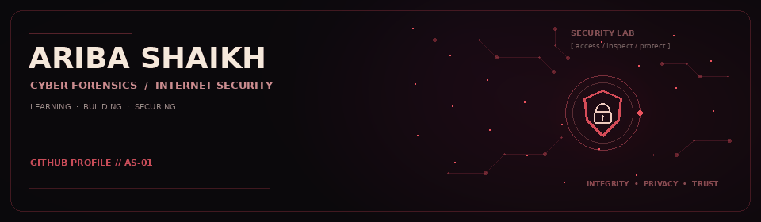

CYBER FORENSICS · FRONTEND ENGINEERING · OPEN SOURCE

 

`IDENTITY FILE // AS-01` &nbsp; `STATUS: LEARNING · BUILDING · SECURING`

  

&nbsp;

&nbsp;

  

&nbsp;

&nbsp;

---

<h2 align="center">01 — THE OPERATOR</h2>

**Frontend developer in progress. Cybersecurity at the core.**

I build thoughtful web experiences and study the systems that keep them trustworthy. My focus is growing from frontend development into full-stack engineering, while developing a practical foundation in cyber forensics and application security.

<table align="center">
<tr>
<td align="center" width="33%">

**Build**

Responsive interfaces · UX · Web apps

</td>
<td align="center" width="34%">

**Protect**

Cyber forensics · Secure coding · Security fundamentals

</td>
<td align="center" width="33%">

**Collaborate**

Git · GitHub · Projects · Hackathons

</td>
</tr>
</table>

---

<h2 align="center">02 — QUICK SCAN</h2>

<table align="center">
<tr>
<td width="50%" valign="top">

<strong>EDUCATION</strong>

B.Tech — Cyber Forensics & Internet Security  
Ajeenkya DY Patil University

<strong>CURRENT FOCUS</strong>

Frontend development, secure application design, and backend fundamentals.

</td>
<td width="50%" valign="top">

<strong>EXPERIENCE</strong>

Frontend Developer Intern — TalentPlay  
Frontend Developer Intern — Sankalp  
Frontend Developer Intern — FortVerse  
Open Source Contributor — Code-Not-Found

<strong>OPEN TO</strong>

Internships · Freelance projects · Open-source collaboration · Hackathons

</td>
</tr>
</table>

> *My north star: build interfaces people enjoy using, understand the systems underneath, and keep security in the room from day one.*

---

<h2 align="center">03 — TOOLKIT</h2>

<strong>CORE TOOLS</strong>

<strong>CURRENTLY EXPANDING</strong>

<table align="center">
<tr>
<td width="33%" valign="top">

<strong>01 / FRONTEND</strong>

- HTML & CSS
- JavaScript
- Next.js
- Responsive UI
- Interface design

</td>
<td width="33%" valign="top">

<strong>02 / SECURITY</strong>

- Cybersecurity fundamentals
- Secure coding mindset
- Digital forensics studies
- Web application security
- Authorized lab practice

</td>
<td width="34%" valign="top">

<strong>03 / BUILD &amp; LEARN</strong>

- Python
- Git & GitHub
- Flask basics
- Backend & APIs
- Full-stack development
- AI / ML exploration

</td>
</tr>
</table>

 
 

---

<h2 align="center">04 — FEATURED BUILDS</h2>

<strong>CASE 001 — VeriCert</strong> &nbsp; · &nbsp; Digital Certificate Verification System &nbsp; <code>↗ Expand case file</code>

 

A web-based certificate verification concept designed to make authenticity checks easier and help identify tampered records.

<strong>Case highlights</strong>
- QR-based certificate validation
- Hash-integrity checks
- Admin certificate management
- Student verification flow

<strong>Stack:</strong> `JavaScript` `HTML` `CSS`

[**VIEW REPOSITORY ↗**](https://github.com/aribashaikh02/vericert) &nbsp; · &nbsp; [Live website ↗](https://aribashaikh02.github.io/vericert/)

<strong>CASE 002 — Website Screenshot Generator</strong> &nbsp; · &nbsp; Flask web tool &nbsp; <code>↗ Expand case file</code>

 

A Flask-based web tool that accepts a URL, requests a screenshot through the ScreenshotBase API, and displays the generated image.

<strong>Case highlights</strong>
- URL-to-screenshot workflow
- Format and full-page options
- In-browser preview
- Lightweight Flask app

<strong>Stack:</strong> `Python` `Flask` `Jinja2` `Bootstrap`

[**VIEW REPOSITORY ↗**](https://github.com/aribashaikh02/screenshot-generator-website) &nbsp; · &nbsp; [Live website ↗](https://screenshot-generator-website.onrender.com/)

<strong>CASE 003 — Cybersecurity Project Lab</strong> &nbsp; · &nbsp; Security learning lab &nbsp; <code>↗ Expand case file</code>

 

A learning space for practical cybersecurity projects, tools, and experiments as the security portfolio grows.

[**OPEN PROJECT LAB ↗**](https://github.com/aribashaikh02/Cybersecurity-Project-Lab)

<strong>CASE 004 — Problem-Solving Practice</strong> &nbsp; · &nbsp; Coding exercises &nbsp; <code>↗ Expand case file</code>

 

A collection of coding practice and algorithm exercises to build consistency and strengthen problem-solving fundamentals.

[**OPEN LEETCODE REPO ↗**](https://github.com/aribashaikh02/leetcode)

---

<h2 align="center">05 — EXPERIENCE LOG</h2>

<table align="center">
<tr>
<td valign="top" width="24%">

**FRONTEND DEVELOPER INTERN**

</td>
<td valign="top" width="24%">

**TalentPlay**

Startup internship

</td>
<td valign="top" width="24%">

**Sankalp**

University-sponsored internship

</td>
<td valign="top" width="28%">

**FortVerse**

University-sponsored internship

</td>
</tr>
</table>

<strong>OPEN-SOURCE CONTRIBUTION</strong>  
[Code-Not-Found ↗](https://github.com/Shubhajit137/Code-Not-Found)

---

<h2 align="center">06 — GITHUB SIGNAL</h2>

  

---

<h2 align="center">07 — CURRENT QUESTS</h2>

<table align="center">
<tr>
<td width="50%" valign="top">

<strong>IN THE WORKSHOP</strong>

Build responsive web applications  
Create practical cybersecurity projects  
Strengthen backend and API fundamentals  
Apply secure coding principles  
Improve Git and GitHub workflows

</td>
<td width="50%" valign="top">

<strong>ON THE RADAR</strong>

Full-stack development  
Web application security  
Digital forensics and incident response  
Network security and vulnerability assessment  
Ethical hacking in authorized lab environments  
Python security automation  
AI / ML foundations

</td>
</tr>
</table>

---

<h2 align="center">08 — OPEN CHANNEL</h2>

**Have a project, security idea, or open-source issue? Let's connect.**

&nbsp;

&nbsp;

  

`END OF FILE` &nbsp; · &nbsp; `KEEP BUILDING. KEEP QUESTIONING.`

