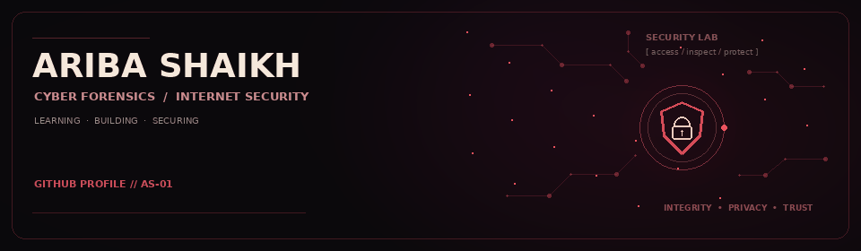

CYBER FORENSICS · FULL-STACK ENGINEERING · OPEN SOURCE

 

`IDENTITY FILE // AS-01` &nbsp; `STATUS: LEARNING · BUILDING · SECURING`

  

&nbsp;

&nbsp;

  

&nbsp;

&nbsp;

&nbsp;

  

<a href="#01--the-operator">OPERATOR</a> &nbsp;·&nbsp;
<a href="#02--quick-scan">QUICK SCAN</a> &nbsp;·&nbsp;
<a href="#03--toolkit">TOOLKIT</a> &nbsp;·&nbsp;
<a href="#04--featured-builds">BUILDS</a> &nbsp;·&nbsp;
<a href="#05--experience-log">EXPERIENCE</a> &nbsp;·&nbsp;
<a href="#08--open-channel">CONTACT</a>

---

## 01 — THE OPERATOR

**Frontend developer in progress. Cybersecurity at the core.**

I build thoughtful web experiences and study the systems that keep them trustworthy. My focus is growing from frontend development into full-stack engineering, while developing a practical foundation in cyber forensics and application security.

<table align="center">
<tr>
<td align="center" width="33%">

**Build**

Responsive interfaces · UX · Web apps

</td>
<td align="center" width="34%">

**Protect**

Cyber forensics · Secure coding · Security fundamentals

</td>
<td align="center" width="33%">

**Collaborate**

Git · GitHub · Projects · Hackathons

</td>
</tr>
</table>

---

## 02 — QUICK SCAN

<table align="center">
<tr>
<td width="50%" valign="top" align="center">

**EDUCATION**

B.Tech — Cyber Forensics & Internet Security  
Ajeenkya DY Patil University

**CURRENT FOCUS**

Frontend development, secure application design, and backend fundamentals.

</td>
<td width="50%" valign="top" align="center">

**EXPERIENCE**

Frontend Developer Intern — TalentPlay  
Frontend Developer Intern — Sankalp  
Frontend Developer Intern — FortVerse  
Open Source Contributor — Code-Not-Found

**OPEN TO**

Internships · Freelance projects · Open-source collaboration · Hackathons

</td>
</tr>
</table>

 

> *My north star: build interfaces people enjoy using, understand the systems underneath, and keep security in the room from day one.*

---

## 03 — TOOLKIT

**CORE TOOLS**

**CURRENTLY EXPANDING**

 

<table align="center">
<tr>
<td width="33%" valign="top">

**01 / FRONTEND**

- HTML & CSS
- JavaScript
- Next.js
- Responsive UI
- Interface design

</td>
<td width="33%" valign="top">

**02 / SECURITY**

- Cybersecurity fundamentals
- Secure coding mindset
- Digital forensics studies
- Web application security
- Authorized lab practice

</td>
<td width="34%" valign="top">

**03 / BUILD & LEARN**

- Python
- Git & GitHub
- Flask basics
- Backend & APIs
- Full-stack development
- AI / ML exploration

</td>
</tr>
</table>

---

## 04 — FEATURED BUILDS

<strong>CASE 001 — Portfolio</strong> &nbsp; · &nbsp; Personal portfolio website &nbsp; <code>↗ Expand case file</code>

 

My personal portfolio showcasing projects, skills, and experience in one place.

<strong>CASE 002 — VeriCert</strong> &nbsp; · &nbsp; Digital Certificate Verification System &nbsp; <code>↗ Expand case file</code>

 

A web-based certificate verification concept designed to make authenticity checks easier and help identify tampered records.

**Case highlights**
- QR-based certificate validation
- Hash-integrity checks
- Admin certificate management
- Student verification flow

**Stack:** `JavaScript` `HTML` `CSS`

&nbsp;

<strong>CASE 003 — Website Screenshot Generator</strong> &nbsp; · &nbsp; Flask web tool &nbsp; <code>↗ Expand case file</code>

 

A Flask-based web tool that accepts a URL, requests a screenshot through the ScreenshotBase API, and displays the generated image.

**Case highlights**
- URL-to-screenshot workflow
- Format and full-page options
- In-browser preview
- Lightweight Flask app

**Stack:** `Python` `Flask` `Jinja2` `Bootstrap`

&nbsp;

<strong>CASE 004 — Cybersecurity Project Lab</strong> &nbsp; · &nbsp; Security learning lab &nbsp; <code>↗ Expand case file</code>

 

A learning space for practical cybersecurity projects, tools, and experiments as the security portfolio grows.

<strong>CASE 005 — Problem-Solving Practice</strong> &nbsp; · &nbsp; Coding exercises &nbsp; <code>↗ Expand case file</code>

 

A collection of coding practice and algorithm exercises to build consistency and strengthen problem-solving fundamentals.

---

## 05 — EXPERIENCE LOG

<table align="center">
<tr>
<th>ROLE</th>
<th>ORGANIZATION</th>
<th>TYPE</th>
</tr>
<tr>
<td>Frontend Developer Intern</td>
<td><b>TalentPlay</b></td>
<td>Startup internship</td>
</tr>
<tr>
<td>Frontend Developer Intern</td>
<td><b>Sankalp</b></td>
<td>University-sponsored internship</td>
</tr>
<tr>
<td>Frontend Developer Intern</td>
<td><b>FortVerse</b></td>
<td>University-sponsored internship</td>
</tr>
<tr>
<td>Open Source Contributor</td>
<td><b><a href="https://github.com/Shubhajit137/Code-Not-Found.git">Code-Not-Found ↗</a></b></td>
<td>Open source</td>
</tr>
</table>

---

## 06 — GITHUB SIGNAL

  

---

## 07 — CURRENT QUESTS

<table align="center">
<tr>
<td width="50%" valign="top" align="center">

**IN THE WORKSHOP**

Build responsive web applications  
Create practical cybersecurity projects  
Strengthen backend and API fundamentals  
Apply secure coding principles  
Improve Git and GitHub workflows

</td>
<td width="50%" valign="top" align="center">

**ON THE RADAR**

Full-stack development  
Web application security  
Digital forensics and incident response  
Network security and vulnerability assessment  
Ethical hacking in authorized lab environments  
Python security automation  
AI / ML foundations

</td>
</tr>
</table>

---

## 08 — OPEN CHANNEL

**Have a project, security idea, or open-source issue? Let's connect.**

&nbsp;

&nbsp;

  

`END OF FILE` &nbsp; · &nbsp; `KEEP BUILDING. KEEP QUESTIONING.`

